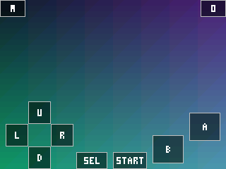

# ESP32-S3 NES 触摸掌机

基于 [Retro-Go](https://github.com/ducalex/retro-go) 的实战派 ESP32-S3 NES 游戏工程。
使用板载 ST7789 屏幕、触摸虚拟手柄、TF 卡和 ES8311 音频，让开发板运行红白机游戏。
工程保留 Nofrendo 模拟器核心，增加本板驱动、中文源码注释和学习文档。

## 已实现的功能

- **显示与操作**：320×240 游戏画面、菜单、半透明触摸按键，最多两个触点。
- **游戏与存档**：从 TF 卡读取 `.nes` 文件，支持游戏菜单、保存和读取存档。
- **声音输出**：通过 ES8311 和板载功放驱动已连接的扬声器。
- **已有 TF 卡兼容**：识别多分区卡，选择最大的有效 FAT32 数据分区；挂载过程不会格式化或重新分区。
- **学习入口**：提供自编测试游戏及中文注释，可跟踪启动、显示、触摸、存储和音频的数据流。

菜单、触摸、测试游戏画面和扬声器已完成实机验证；自编测试游戏的存档、读档及应用切换已通过。
另已验证《Böbl 1.1》加载运行。其他游戏完整流程、其他模拟器及长时间稳定性仍需实际测试，
详细结果见 [实机验证记录](VALIDATION_SZPI.md)。



上图由实际 C 绘图代码在电脑上生成，用于说明按键布局，不是实机游戏截图。

## 硬件要求

适配 **立创实战派 ESP32-S3 开发板（ESP32-S3-WROOM-1-N16R8）**。

| 部件 | 本工程使用方式 |
|---|---|
| ESP32-S3 | 240 MHz，16 MB Flash，8 MB Octal PSRAM |
| ST7789 屏幕 | 320×240，SPI 接口；片选由 PCA9557 控制 |
| FT6336 触摸 | I²C 接口，转换为方向和游戏按键 |
| TF 卡 | SDMMC 单线模式，FAT32 数据分区 |
| ES8311 与功放 | I²S 音频输出，需连接扬声器 |
| BOOT 按键 | 打开系统菜单 |

具体 GPIO、总线参数和初始化说明见 [本板使用说明](README_SZPI.md#硬件)。

## 打开工程、编译与烧录

使用 **ESP-IDF 5.2.3**。VS Code 打开根目录的 **[SZPI-NES.code-workspace](SZPI-NES.code-workspace)**，
工作区中的 `retro-core` 是 ESP-IDF 工程；仓库根目录由 `rg_tool.py` 管理两个应用。

在已配置好工具链的本机，进入仓库根目录执行：

```powershell
# 编译并打包 launcher（游戏列表）和 retro-core（模拟器）
.\build-szpi.ps1

# 编译成功后烧录已有完整镜像；将 COM5 改为实际串口
.\build-szpi.ps1 -Action flash -Port COM5
```

`flash` 使用已经生成的镜像；修改源码后应先重新编译。完整镜像写入 Flash 的 **0x0**，
会替换板上原有启动分区和应用，不适用于旧 OTA 工程的网页上传入口。

脚本优先读取 `IDF_PATH` 和 `IDF_TOOLS_PATH`，未设置时查找旁边 `bootload` 目录中的本机工具链。
工具链不随仓库分发；换电脑时可指定安装位置，并同步调整 VS Code 工作区内的工具链和串口设置：

```powershell
.\build-szpi.ps1 -IdfPath 'D:\esp\esp-idf-v5.2.3' -IdfToolsPath 'D:\esp\tools'
```

完整构建步骤、镜像名称和 VS Code 烧录说明见 [本板使用说明](README_SZPI.md)。

## 准备 TF 卡与游戏

1. 使用 FAT32 数据分区；已有卡能正常挂载时无需格式化，原有文件可以保留。
2. 将自己的或作者允许下载的 `.nes` 文件放入该分区的 **`/roms/nes/`**。
3. 开发板断电后插卡，再上电。首次挂载成功会建立游戏目录，并在缺少同名文件时写入自编测试游戏 `SZPI-Controls.nes`。
4. 在菜单中左右切换到 NES 分类，上下选择游戏，按 A 进入；普通游戏按 START 开始。
5. 自编测试游戏直接运行：方向键移动图案，A 发声，B 变色。

仓库的 `sdcard/roms/nes/` 仅包含自编测试游戏，不附带魂斗罗、超级玛丽等商业 ROM。
上游自带测试资料和其他模拟器资源按原结构及许可证保留。游戏兼容性取决于 Nofrendo 对
具体 ROM 的支持，PSRAM 容量不是唯一条件。

已兼容一张 64 GB 卡的 FAT32 卷长度比 MBR 分区长度多记 1 个未使用尾部扇区的情况，
保留原分区读写边界。遇到挂载错误时先查看串口日志，具体判断过程见 [验证记录](VALIDATION_SZPI.md)。

## 按键操作

| 按键 | 作用 |
|---|---|
| U / D / L / R | 上、下、左、右 |
| A / B | 游戏按键；菜单中确认 / 返回 |
| SEL / START | 选择 / 开始 |
| M 或板上 BOOT | 系统菜单，可保存、读档和返回游戏列表 |
| O | 设置菜单 |

方向与 A/B 可以组合操作；屏幕最多两个触点，不能保证同时按下三个独立按键。

## 从源码开始学习

建议按“启动 → 板级初始化 → TF 读取 → NES 运行 → 图像与声音输出”的顺序阅读。

| 文档或目录 | 阅读内容 |
|---|---|
| [中文学习路线](docs/中文学习路线.md) | 实际函数、调用链和学习练习 |
| [本板使用说明](README_SZPI.md) | 引脚、构建、TF 卡、触摸和调试 |
| [板级适配目录](components/retro-go/targets/szpi-esp32s3/) | 屏幕片选、I²C、触摸、TF 分区及串口控制 |
| [NES 主程序](retro-core/main/main_nes.c) | ROM 载入、按键、画面和音频调度 |
| [移植来源与改动](docs/SZPI_PORT.md) | 适配方法、改动范围和组件来源 |
| [实机验证记录](VALIDATION_SZPI.md) | 黑屏、音频、TF 卡问题的排查和验证证据 |

串口默认 **115200**；端口号按电脑实际识别结果设置。串口输入 `?` 查看调试命令，
`g` 启动自编测试游戏，`c` 读取 TF 卡根目录的 `crash.log`。

## 来源、致谢与许可

本工程基于 [ducalex/retro-go](https://github.com/ducalex/retro-go)，固定上游提交
`4ced120669750ca7228fd0414211430c1d923166`。感谢 Retro-Go、Nofrendo 和相关开源组件作者。
原版英文介绍、功能说明和完整致谢保存在 [上游原始说明](README_UPSTREAM.md)。

Retro-Go 主体遵循 [GPLv2 许可](COPYING)；上游说明列明 fMSX 使用自定义非商业许可，
Handy 使用 zlib 许可。本工程引入的 `esp_codec_dev` 使用 Apache-2.0 许可；
其余第三方代码以各目录保留的许可证和版权声明为准，来源见 [移植记录](docs/SZPI_PORT.md)。
