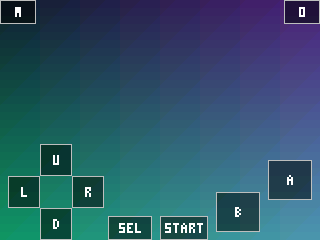

# 实战派 ESP32-S3 NES 独立工程

基于 [ducalex/retro-go](https://github.com/ducalex/retro-go)，固定上游提交
`4ced120669750ca7228fd0414211430c1d923166`。保留 Retro-Go 的 launcher、Nofrendo
NES 核心、游戏菜单、存档、显示缩放及多应用启动方式，仅增加实战派板级适配。
上游说明保留在 [README.md](README.md)，本板使用方法以本文为准。

## 硬件

立创实战派 ESP32-S3，ESP32-S3-WROOM-1-N16R8，16 MB Flash / 8 MB Octal PSRAM。

| 功能 | 本板连接 |
|---|---|
| ST7789 320×240 | SPI3，MOSI 40，CLK 41，DC 39，SPI mode 2，80 MHz |
| LCD 片选 | PCA9557 地址 0x19，IO0，低有效 |
| 屏幕背光 | GPIO42，反相 PWM |
| FT6336 触摸 | I2C0，SDA 1 / SCL 2，地址 0x38，最多两个触点 |
| TF 卡 | SDMMC 1-bit，CLK 47，CMD 48，D0 21 |
| ES8311 播放 | I2S0，MCLK 38，BCLK 14，WS 13，DOUT 45 |
| 功放使能 | PCA9557 IO1，高有效 |
| BOOT 用户键 | GPIO0，低有效，打开 Retro-Go 菜单 |

游戏工程关闭摄像头，不初始化 AI、麦克风或联网服务。PSRAM 用于模拟器数据、
ROM 及图像缓冲；显示适配层使用内部 DMA staging buffer 接到 IDF ST7789 驱动。

## 编译

使用 ESP-IDF **5.2.3**。本机可以直接运行：

```powershell
cd D:\Users\lenovo\Documents\ChatGPT\esp32_s3_nes
.\build-szpi.ps1
```

脚本优先使用 `IDF_PATH` / `IDF_TOOLS_PATH`，未设置时复用旁边 bootload 的本机
工具链。它只读取工具链，不依赖旧工程的源码或配置。其他电脑可指定独立工具链：

```powershell
.\build-szpi.ps1 -IdfPath 'D:\esp\esp-idf-v5.2.3' -IdfToolsPath 'D:\esp\tools'
```

在已经配置好的 IDF 终端，也可以按上游方式构建：

```powershell
python rg_tool.py --target=szpi-esp32s3 --no-networking build-img launcher retro-core
```

完整镜像为 `szpi-nes_0.1.0_szpi-esp32s3.img`，从 Flash 地址 **0x0** 写入。
镜像包含 Bootloader、分区表、launcher 和 retro-core；不适用于旧 OTA 工程的网页
上传入口。`retro-core` 保留上游捆绑的模拟器，第一版主要验证 NES 路径。

生成镜像不会烧录开发板。需要烧录时，在 IDF 终端将 `COMx` 替换为实际串口：

```powershell
python -m esptool --chip esp32s3 -p COMx -b 460800 write_flash 0x0 szpi-nes_0.1.0_szpi-esp32s3.img
```

首次写完整镜像会替换板端现有启动分区和应用。旧 OTA/AI 源码工程仍在原目录。

## 准备游戏

1. 可以直接保留已有 TF 卡分区。ESP32 会读取 MBR 和 FAT BPB，选择最大的有效
   FAT32 分区；这张 K230 旧卡对应之前电脑里的 G:，不会选前面的 BIN / SDCARD。
2. 首次挂载成功会自动新建 `roms/nes`，并写入自编的 `SZPI-Controls.nes` 测试 ROM。
   同名文件已经存在时不覆盖，也不会格式化或重新分区。
3. 其他 `.nes` 游戏放到该数据分区的 **`/roms/nes/`**，例如 `/roms/nes/game.nes`。
4. 断电插卡，再上电；左右方向切换到 NES 分类，上下选游戏，A 确认。
5. 普通游戏按 START 开始。测试 ROM 直接运行；方向移动图案，A 发声，B 变色。
   M / 板上 BOOT 打开游戏菜单，可保存、读取存档和回到 launcher。

固件不含魂斗罗、超级玛丽等商业 ROM，提供自己的控制测试 ROM。具体游戏能否运行还取决于上游 Nofrendo
对该 ROM 的 mapper 支持，PSRAM 容量不是唯一条件。SD 挂载失败时不会自动格式化卡。

## 虚拟手柄

板上只有一个用户键，因此板级适配增加固定位置的半透明触摸按键。
触摸仍转换成 Retro-Go 原有 `RG_KEY_*`，不改变 NES 核心或菜单逻辑。



上图为 C 绘图代码在主机上的布局预览，渐变背景用于显示透明效果，不是实机游戏截图。

- U/D/L/R：方向；A：确认/游戏 A；B：返回/游戏 B。
- SEL / START：Select / Start；M：系统菜单；O：设置菜单。
- 支持同时触摸方向和 A/B；方向盘角落支持斜向。屏幕最多两个触点，无法保证三个
  独立按键同时按下。触摸硬件的实际双点跟踪效果仍需上板确认。
- 触摸坐标沿用旧 BSP 的方向：先镜像原始 X，再交换 X/Y。若实际屏幕方向不同，
  修改 `szpi_touch.c` 的坐标转换，并重新运行测试。

## 测试和验收

```powershell
.\test-szpi.ps1
python tests/check_szpi_image.py
```

这会在 Windows 主机运行三组真实 C 测试：触摸解码与绘制边界、多分区识别及扇区
映射、Nofrendo 执行自编测试 ROM（方向、图像变化及 APU 非零采样）。

构建和主机测试只验证软件。上板还要确认：PSRAM 检测、LCD 方向/颜色、TF 挂载、
触摸方向与双点组合、游戏帧率、ES8311 声音、存档后重启恢复。
本机已通过 COM5 烧录并实测 TF 第 3 分区读写、8 MB PSRAM 及测试 ROM 运行。
屏幕、实体触摸、扬声器的实际表现与串口初始化结果分开记录，详见
[验证记录](VALIDATION_SZPI.md)。

板级改动和来源详见 [docs/SZPI_PORT.md](docs/SZPI_PORT.md)。

## VS Code 与中文学习注释

打开根目录的 **`SZPI-NES.code-workspace`**，它把 `retro-core` 作为真正的 IDF
工程目录。仓库根目录由 `rg_tool.py` 管理两个应用，本身没有 `CMakeLists.txt`，
不能直接作为 IDF 扩展的工程目录。

工作区已设置 ESP32-S3、COM5、UART 烧录和 115200 串口。ESP-IDF 编译完成后的
命令会更新 launcher + retro-core 完整镜像；普通烧录写完整镜像到 0x0，
单独 app-flash 写 retro-core 到 0x210000。`Ctrl+Shift+B` 也可以更新完整镜像。
IntelliSense 使用 retro-core 的真实编译命令。

中文注释集中在板级 target、TF 多分区驱动、音频驱动以及 NES 主循环。
按 [中文学习路线](docs/中文学习路线.md) 阅读，可从实际引脚一路跟到 CPU/PPU/APU。
调试串口是 COM5、115200；`?` 查看命令，`g` 启动自编测试 ROM，`c` 只读 TF
根目录的 `crash.log`，便于排查屏幕上出现的 System Panic 提示。
